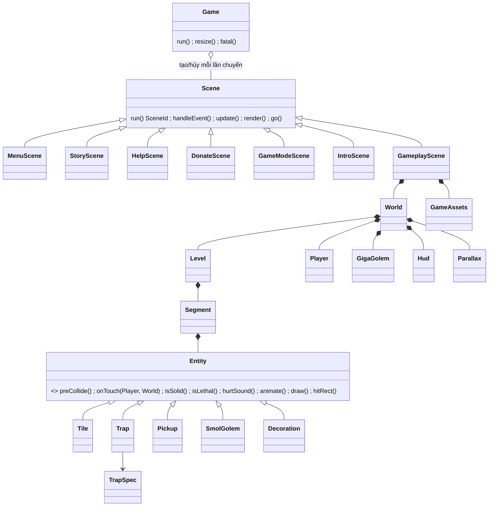

# Jungle Run — Thiết kế chuyển C sang C++ (OOP)

Ngày: 2026-10-23 · Trạng thái: **APPROVED** (review đa góc nhìn), chờ GĐ0 (chạy thử branch C) trước khi triển khai

Nền: branch `refactor/scene-loop-memleak` (~2.400 dòng C, xem [2026-10-23-refactor-memory-leak-design.md](2026-10-23-refactor-memory-leak-design.md)).

## 1. Tóm tắt hiểu biết

- **Làm gì:** chuyển toàn bộ source C sang C++ hướng đối tượng: entity đa hình cho bẫy/item/golem; Player, GigaGolem, Level, World, Hud, Scene, Game là class; tài nguyên SDL theo RAII; dữ liệu level và thứ tự đường chạy ra file text.
- **Vì sao:** dễ bảo trì, mở rộng — thêm bẫy/màn không phải sửa các `switch` lớn. OOP dùng ở chỗ có ích, không trình diễn.
- **Cho ai:** nhóm phát triển game.
- **Ràng buộc:** triển khai sau khi branch C được chạy thử và merge; giữ Visual Studio `.vcxproj` x64 + SDL2; gameplay/hình/luồng màn giống hệt bản C — **ngoại lệ có chủ đích duy nhất:** lỗi nạp file level/asset khi vào gameplay → message box rồi về menu (bản C thoát game), xem #22; máy dev chỉ build, người dùng chạy checklist.
- **Non-goals:** tính năng mới, đổi UI, multiplayer, unit test lâu dài (chỉ có kiểm tra song song C/C++ tạm thời ở GĐ1, #35), CMake, thay SDL2 hay dùng wrapper bên thứ ba.

## 2. Giả định

1. C++17 (toolset v143 hỗ trợ). Không dùng exception cho luồng điều khiển; lỗi nạp tài nguyên → message box, rời scene.
2. RAII bằng `std::unique_ptr` + deleter; không có `new`/`delete` thủ công.
3. Giữ bộ đếm tài nguyên trên tiêu đề cửa sổ (Debug).
4. 60fps theo vsync; vài nghìn entity → duyệt `vector` tuyến tính là đủ.
5. File level đọc khi vào gameplay; file hỏng → báo tên file + số dòng, không crash.
6. Mã ô 0–22 giữ nguyên ý nghĩa trong file text.
7. Tên file/class `PascalCase`, mỗi class lớn một cặp `.h/.cpp`.

## 3. Nhật ký quyết định

| # | Quyết định | Phương án khác | Lý do |
|---|-----------|----------------|-------|
| 1 | Mục đích: bảo trì, mở rộng | Đồ án OOP; học C++ hiện đại | Người dùng chọn |
| 2 | Nền: branch C sau khi chạy thử | Làm ngay; từ `main` | Không lẫn bug của hai đợt |
| 3 | Entity đa hình | Chỉ class hệ thống; chỉ đổi đuôi | Thêm bẫy = thêm class/spec, không sửa switch |
| 4 | Level ra file text | Giữ mảng trong code | Người dùng chọn: sửa map không cần build |
| 5 | Thứ tự đường chạy ra `course.txt` | Giữ trong code | Thêm/bớt/đổi thứ tự màn không sửa code |
| 6 | Không unit test | Project test doctest | Người dùng chọn |
| 7 | Hệ class nông (Tile, Trap, Pickup, SmolGolem, Decoration) + bảng `TrapSpec` | Mỗi loại bẫy một class; ECS | 22 mã ô chỉ có 5 kiểu hành vi; 18 class gần giống nhau là trùng lặp; ECS quá mức |
| 8 | `TrapSpec` nằm trong code (`EntityFactory.cpp`) | Ra file | Là định nghĩa hành vi, không phải dữ liệu map |
| 9 | `Scene::run()` Template Method, scene là object RAII tạo/hủy mỗi lần chuyển | Mỗi scene tự viết vòng lặp | Gộp 7 vòng lặp copy-paste; tài nguyên tự giải phóng |
| 10 | `ui::Button` cho mọi chữ hover/click | Viết lại ở từng màn | Mẫu lặp nhiều nhất trong menu |
| 11 | Lỗi vào gameplay → message box, về menu | Thoát game | Không mất phiên chơi vì một file hỏng |
| 12 | Chuyển level bằng script + so khớp ngược | Gõ tay | Tránh sai lệch map khi chuyển |
| 13 | ~~Giai đoạn có cầu nối `extern "C"`~~ → thay bởi #17 | Đổi một lần | — |
| 14 | Hai đường va chạm: nền đất float không gate, ô map gate bằng rect int | Một `intersects()` chung | Review S1/S2: bản C khác nhau, gộp lại đổi cảm giác va chạm và hiệu ứng nháy đỏ |
| 15 | `Level` = `vector<Segment>`; đổi lv15→lv14 hoãn tới trước render, thay tại chỗ | Rebuild trong `onTouch` | Review S3: tránh iterator hỏng, giữ thời điểm như C |
| 16 | Trap lưu cờ lethal/solid, cập nhật ở `animate()` pha render; solid 3 trạng thái; `preCollide()` cho golem | Tính thuần từ thời gian; `update()` riêng | Review S7/S8: giữ độ trễ 1 frame và thứ tự di chuyển golem của C |
| 17 | Bỏ cầu nối `extern "C"`: GĐ1 dựng model C++ song song, GĐ2 chuyển scene + xóa C | Cầu nối | Review S9: trùng `SceneId`, thiếu guard, App C phải đồng bộ, 2 bộ đếm |
| 18 | Intro và Gameplay override `run()`; Template Method chỉ cho 5 màn menu | Template cho cả 7 | Review S5/S12: back-buffer xen kẽ của intro, thứ tự đọc phím của gameplay |
| 19 | `finish` trong `course.txt` | Hằng số trong code | Review S6: để “đổi thứ tự màn không sửa code” là đúng |
| 20 | Class `Parallax` riêng; course parse 1 lần, Retry dựng từ RAM | Không chỉ định | Review S10 |
| 21 | Danh sách đặc điểm Player phải giữ (4.5b) | Để ngầm | Review S4: tránh “sửa” hành vi không chủ ý |
| 22 | Giữ #11 (lỗi → về menu) là thay đổi luồng có chủ đích | Theo C: thoát | Review S11: người dùng đã duyệt; ghi rõ là khác C |
| 23 | Rủi ro S13 (TrapSpec/thứ tự va chạm không có kiểm chứng tự động) | — | Người dùng quyết → #35 |
| 35 | Kiểm tra song song C/C++ (`tools/parity`) ở GĐ1, xóa ở GĐ2 | Chấp nhận rủi ro, so bằng mắt; unit test đầy đủ | Người dùng chọn: bắt lệch hành vi ngay trên máy dev, không giữ test lâu dài |
| 24 | Bật `stdcpp17`; `/W4` theo file ở GĐ1, toàn project ở GĐ2 | Giữ mặc định | Review G1/G3: mặc định là C++14 |
| 25 | `main(int, char*[])`, `Game::ok()`, kiểm `next` trước frame đầu | — | Review G2/G8 |
| 26 | `std::from_chars`, chấp nhận BOM/CRLF | `std::stoi` | Review G5: không exception, file sửa tay |
| 27 | Halt âm thanh tường minh ở 3 chỗ; cấm handle RAII static; GameAssets trước World | Dựa vào RAII | Review G6/G7 |
| 28 | Legend comment trong mỗi `lvNN.txt` + mục README “Level format” | Chỉ tài liệu thiết kế | Review U1: người sửa map không phải đọc C++ |
| 29 | `onkey lv15 lv14` thay cho `lv15>lv14`; `finish` có đơn vị, kiểm ≤ chiều dài course | Cú pháp `>`; không kiểm | Review U2/U3: dễ đọc, sai số được báo |
| 30 | Thông báo lỗi tiếng Anh, `line N` vật lý, đường dẫn đầy đủ, kết thúc `Returning to menu.` | Tiếng Việt, basename | Review U4: UI tiếng Anh, tránh C4819 |
| 31 | `TrapSpec` định nghĩa rõ + công thức thêm mã 23; checklist ghi rõ mốc và áp dụng theo GĐ | Suy ra từ bảng | Review U5–U8 |
| 32 | Hit test của golem dùng bounds chụp **trước** `preCollide()` | Dùng vị trí sau khi di chuyển | Arbiter: collision.c:21 đọc bx/by trước updateGolem (dòng 24–25) |
| 33 | `TrapSpec::initialLethal` (mã 7, 20 = true) | Mọi Trap bắt đầu lethal = false | Arbiter: map.c:33–35 loadMap đặt isLethal = 1 cho 7/20 |
| 34 | `Scene::run` là `virtual`; bỏ hook `clearEachFrame`; thêm `Entity::hurtSound()` | — | Arbiter: mâu thuẫn nội bộ |

## 4. Thiết kế

### 4.1 Bố cục

```
src/
  main.cpp                 int main(int argc, char* argv[])  // đúng chữ ký này: SDL2main.lib cần SDL_main(int, char**)
                           { Game game; return game.ok() ? game.run() : 1; }
  core/
    Sdl.h/.cpp             SdlSession, AudioDevice; TexturePtr/FontPtr/ChunkPtr/MusicPtr;
                           loadTexture, loadTextureSeq, renderText, loadFont, loadChunk, loadMusic;
                           debug counters (++ khi tạo, -- trong deleter)
    Game.h/.cpp            sở hữu SdlSession, Window, Renderer, AudioDevice, click, menuMusic, Settings;
                           run(): makeScene(id) → scene->run() → hủy → lặp; resize; fatal()
  ui/
    Button.h/.cpp          texture thường/hover, rect, hitTest, draw
  scenes/
    Scene.h/.cpp           abstract, Template Method
    MenuScene StoryScene HelpScene DonateScene GameModeScene IntroScene GameplayScene
  game/
    Config.h               constexpr: lực nhảy, trọng lực, END_OF_GAME_POSITION, kích thước...
    GameAssets.h/.cpp      texture/âm thanh gameplay, TextureId → SDL_Texture*
    Entity.h               abstract
    Tile Trap Pickup SmolGolem Decoration   (.h/.cpp)
    EntityFactory.h/.cpp   mã ô → entity; bảng TrapSpec
    LevelLoader.h/.cpp     course.txt + lvNN.txt → Course
    Level.h/.cpp           entities theo đoạn; collide(Player&, World&); swap đoạn khi có key
    Player GigaGolem Hud Parallax World   (.h/.cpp)
Resource/Levels/
  course.txt  lv00.txt … lv15.txt
tools/
  export_levels.py         levels.c → lvNN.txt + kiểm tra ngược (chạy 1 lần ở GĐ1)
  parity/                  ParityCheck.vcxproj + parity_main.cpp + parity_clock.h (#35, chỉ GĐ1)
```

### 4.2 Sơ đồ class



### 4.3 Scene

```cpp
enum class SceneId { Quit, Menu, Story, Help, Donate, GameMode, Intro, Gameplay };

class Scene {
public:
  virtual ~Scene() = default;
  virtual SceneId run(Game& game);            // mặc định: poll → handleEvent; update(dt); clear; render; present; tick
protected:                                    // Intro/Gameplay override run() (xem dưới)
  virtual void handleEvent(const SDL_Event&) {}
  virtual void update(float) {}
  virtual void render(SDL_Renderer*) {}
  void go(SceneId next);                      // đặt màn kế tiếp, kết thúc vòng lặp
};
```
`SDL_QUIT` xử lý chung trong `Scene::run` → `SceneId::Quit`. Constructor của scene nạp tài nguyên vào member RAII; nạp thiếu → `game.fatal(...)` và `go(Menu)` (gameplay) hoặc `go(Quit)` (menu).

`run()` là `virtual`. Template Method dùng cho 5 màn menu (Menu/Story/Help/Donate/GameMode — nơi có vòng lặp copy-paste). **IntroScene và GameplayScene override `run()`** và giữ nguyên thứ tự vòng lặp bản C:
- Intro: `SDL_Delay(100)` → vẽ → present → `SDL_Delay(60)` → vạch → present, không clear (vẽ cộng dồn vào back-buffer xen kẽ; một present thừa sẽ đổi nội dung buffer).
- Gameplay: đọc `SDL_GetKeyboardState` **trước** khi poll sự kiện; collide → physics → render; thoát vòng ngay khi có màn kế.

`go(next)`: dừng poll ngay (sự kiện còn lại trong hàng đợi để cho màn sau, như `while (next == X && SDL_PollEvent)` bản C), bỏ update/render của frame đó, thoát vòng.

### 4.4 Entity

```cpp
class Entity {
public:
  virtual ~Entity() = default;
  virtual void preCollide(const Player&, float dt) {}  // SmolGolem: dò + di chuyển, ngay trước hit test của chính nó
  virtual void onTouch(Player&, World&) {}
  virtual bool isSolid() const { return false; }
  virtual bool isLethal() const { return false; }
  virtual HurtSound hurtSound() const { return HurtSound::Damage; }  // Trap: theo TrapSpec
  virtual void animate(Uint64 nowMs) {}               // pha render: Trap cập nhật lethal/solid ĐÃ LƯU
  virtual void draw(SDL_Renderer*, const GameAssets&, float scrollX) const = 0;
  const SDL_FRect& bounds() const { return box; }     // float như ledge bản C
  SDL_Rect hitRect() const;                           // (int) cắt cụt như rectB trong collision.c
protected:
  SDL_FRect box{};
};
```

**Trạng thái trễ 1 frame (giữ nguyên bản C):** collision đọc `lethal/solid` do `animate()` ghi ở frame **trước** (bản C ghi cờ trong `drawMap`, chạy sau collision). `Trap` lưu cờ, không tính thuần từ thời gian.

**Solid 3 trạng thái:** mỗi frame của Trap thuộc `solidOn`, `solidOff` hoặc *giữ nguyên*. Mã 8–10: frame 1 → lethal, solid giữ nguyên; 2–7 → solidOn; còn lại → solidOff (map.c, nhánh `smoothness == 1` không đụng `isBlocked`).

```cpp
struct TrapSpec {
  TextureId tex;          // texture trong GameAssets
  int frames, periodMs;   // frame i = nowMs / periodMs % frames
  SDL_Rect src;           // khung nguồn của frame 0
  int stepX;              // khung frame i = src.x + i * stepX
  double angle;           // góc vẽ (0 / 180)
  Uint32 lethalMask;      // bit i = 1 → frame i gây sát thương
  Uint32 solidOnMask;     // bit i = 1 → frame i chặn đường
  Uint32 solidOffMask;    // bit i = 1 → frame i không chặn; frame không thuộc mask nào → giữ trạng thái cũ
  HurtSound sound;        // Damage / Spike / Electric
  int yRows, hRows;       // bounds: y += yRows*50, h = hRows*50 (6: -1,2; 8–10, 15–18: -2,3; còn lại 0,1)
  bool initialLethal;     // true chỉ với mã 7, 20
};
// trạng thái ban đầu (như loadMap, có hiệu lực ở lần collide đầu tiên sau load/Retry, trước animate() đầu tiên):
//   solid = false cho mọi Trap; lethal = false, TRỪ mã 7 và 20 = true (map.c case 7/20); SmolGolem (19) luôn lethal
// → TrapSpec thêm trường bool initialLethal
```

**Công thức thêm một bẫy mới (mã 23):**
1. Thêm ảnh vào `Resource/` và một `TextureId` + dòng nạp trong `GameAssets`.
2. Nếu hành vi giống bẫy hiện có (chạy animation, gây sát thương theo frame): thêm 1 dòng `{23, TrapSpec{...}}` vào bảng trong `EntityFactory.cpp`. Nếu hành vi khác hẳn: thêm class con của `Entity` và 1 dòng `case 23` trong factory.
3. Nâng `kMaxTileCode` trong `LevelLoader` lên 23.
4. Đặt số `23` vào file `lvNN.txt` và cập nhật legend ở đầu file.

Bảng mã ô (trích từ `map.c`/`loadMap` bản C; lưới ô 50×50, “dòng” = 50px):

| Mã | Class | Texture | Frames / ms | Khung nguồn (x,y,w,h) +stepX | Góc | Lethal frame | Solid frame | Âm thanh | Bounds |
|----|-------|---------|-------------|------------------------------|-----|--------------|-------------|----------|--------|
| 1 | Tile | tileset | — | 63,128,50,50 | 0 | — | luôn | — | 1×1 |
| 2 | Tile | tileset | — | 463,144,50,50 | 0 | — | luôn | — | 1×1 |
| 3 | Tile | tileset | — | 320,144,113,49 | 0 | — | luôn | — | rộng 3 ô |
| 4 | Trap | fire1 | 9 / 200 | 8,31,16,33 +32 | 0 | 4,5 | — | Damage | 1×1 |
| 5 | Trap | fire2 | 9 / 175 | 3,25,26,40 +32 | 0 | 4,5 | — | Damage | 1×1 |
| 6 | Trap | fire3 | 9 / 250 | 3,0,26,64 +32 | 0 | 4–8 | — | Damage | y −1 dòng, cao 2 |
| 7 | Trap | ceiling | 6 / 250 | 16,0,33,20 +0 | 180 | 0 | — | Damage | 1×1 |
| 8 | Trap | ceiling | 14 / 250 | 15,0,34,64 +64 | 0 | 1 | 2–7 | Spike | y −2 dòng, cao 3 |
| 9 | Trap | ceiling | 14 / 150 | như 8 | 0 | 1 | 2–7 | Spike | như 8 |
| 10 | Trap | ceiling | 14 / 75 | như 8 | 0 | 1 | 2–7 | Spike | như 8 |
| 11 | Trap | saw | 16 / 150 | 13,0,39,35 +64 | 180 | trừ 0,7,14,15 | — | Damage | 1×1 |
| 12 | Trap | saw | 16 / 150 | như 11 | 0 | trừ 0,6,7,13,14,15 | — | Damage | 1×1 |
| 13 | Pickup FirstAid | items | 7 / 100 | i·32, 128, 32, 32 | 0 | — | — | ItemPickUp | 1×1 |
| 14 | Pickup Potion | items | 8 / 100 | i·32, 288, 32, 32 | 0 | — | — | ItemPickUp | 1×1 |
| 15–18 | Trap | lightning2 | 12 / 150,130,110,100 | 31,0,34,96 +96 | 0 | 3–10 | — | Electric | y −2 dòng, cao 3 |
| 19 | SmolGolem | golem | 8 / 100 | 24+i·100,124,50,50 | lật theo hướng | luôn | — | Damage | 1×1, di chuyển |
| 20 | Trap | ceiling | 6 / 250 | 16,0,33,20 +0 | 0 | 0 | — | Damage | 1×1 |
| 21 | Pickup Key | items | 8 / 100 | i·32, 416, 32, 32 | 0 | — | — | ItemPickUp | 1×1 |
| 22 | Decoration | sparkle | 16 / 100 | (i%4)·32, (i/4)·32, 32, 32 | 0 | — | — | — | 1×1 |

Frame `i = nowMs / periodMs % frames` (đồng hồ toàn cục như bản C), tính trong `Trap::animate()` ở pha render; `animate()` ghi cờ lethal/solid đã lưu theo mask (solid 3 trạng thái), collision frame sau đọc cờ đó — xem “Trạng thái trễ 1 frame” ở trên.

### 4.5 Va chạm (giữ thứ tự bản C)

Hai đường va chạm **khác nhau** như bản C (collision.c):

```
Level::collideGround(Player& p):       // = collision_detect_floor
  for g in grounds:                    // 50 nền đất, float, KHÔNG kiểm tra giao trước,
    p.resolveAgainst(g.bounds())       // KHÔNG xóa isTakenDamage

Level::collideSegments(Player& p, World& w, float dt):   // = collision_detect_map, theo thứ tự course
  for seg in segments: for e in seg.entities:
    SDL_FRect b = e.bounds()           // chụp TRƯỚC khi golem di chuyển (C đọc bx/by trước updateGolem)
    SDL_Rect pr = p.hitRect(), er = toIntRect(b)
    e.preCollide(p, dt)                // SmolGolem dò + di chuyển; hit test frame này vẫn dùng vị trí cũ
    if e is Pickup Key && taken: w.setKeyObtained()     // kiểm TRƯỚC hit test → có hiệu lực từ frame sau, như C
    if SDL_HasIntersection(&pr, &er):  // rect int cắt cụt, như rectA/rectB
      e.onTouch(p, w)                  // Pickup: lấy 1 lần + hiệu ứng + âm thanh
      if !e.isSolid(): if e.isLethal(): p.hurt(e.hurtSound())
      else: p.clearHurt(); p.resolveAgainst(b)   // chỉ ô map mới xóa isTakenDamage
```

`Player::hurt(sound)`: bỏ qua nếu đang bất tử; ngược lại trừ máu, `isTakenDamage = 1`, bất tử 1s, phát âm thanh. FirstAid: `lives = min(lives+1, difficulty)`; Potion: `w.addPotion()`.

**Key → đổi lv15 thành lv14:** `Level` giữ `vector<Segment>`, mỗi `Segment` có `vector<unique_ptr<Entity>>` riêng. Đổi được **hoãn đến pha render** (`do_render` bản C kiểm `isKeyObtained && !flag` trước khi vẽ map): `World::beforeRender()` thay `entities` của segment được khai báo trong dòng `onkey` bằng entity dựng từ lưới thay thế, cùng vị trí, cùng chỗ trong thứ tự — không bao giờ sửa vector đang được duyệt.

### 4.5b Đặc điểm Player phải giữ nguyên (port nguyên văn, không “sửa”)

- Hitbox khi chạy dùng kích thước **idle** 38×64 (sprite chạy 42×66) — `load_player_info`.
- `onLedge` chỉ bị xóa khi nhảy → rơi khỏi mép vẫn nhảy được trên không.
- `resolveAgainst` = `collision_correction` chép nguyên: sửa `x` rồi vẫn kiểm đầu/đáp đất bằng `px/py` cũ; âm thanh đáp đất chỉ khi `!onLedge`.
- Phím xuống cộng `dy += 0.3`; thả phím: `dx *= 0.8`, < 0.1 → 0; giới hạn ±2.5; nhảy `dy = -9`; trọng lực 0.25 cộng sau khi di chuyển.
- Trạng thái animation 0–4 và cách chọn frame như `do_render`/`add_physics`.

### 4.6 File level

```
# course.txt — con trỏ x bắt đầu 0
ground 3              # 3 nền đất, mỗi cái 336px (Platform 3)
map lv00              # 1 đoạn 1200px
ground 2
map lv01
ground 2
map lv02
ground 2
map lv03
ground 2
map lv04
ground 2
map lv05 lv06
ground 2
map lv07 lv08
ground 2
map lv09
ground 2
map lv10
ground 2
map lv11 lv12
ground 2
map lv13 lv15
ground 27
onkey lv15 lv14       # nhặt key (ô mã 21) ở bất kỳ đâu → thay đoạn lv15 bằng lưới lv14, cùng vị trí
finish 25500          # đơn vị: pixel tính từ mép trái course; player.x >= finish → kết thúc
                      # (course hiện dài 50×336 + 15×1200 = 34800px)
```
Tương đương `drawMap_SingleplayerMode` (50 nền đất; map ở mốc i đặt tại `ledges[i-1].x + 336`).
`lvNN.txt`: đúng 16 dòng × 24 số, mã 0–22, `#` là comment.

Parse không dùng exception: số đọc bằng `std::from_chars` (không dùng `std::stoi`). Chấp nhận UTF-8 BOM đầu file và xuống dòng CRLF/LF (file sửa tay trên Windows).

Course + lưới được **parse một lần** khi vào gameplay. Retry (R) dựng lại entity từ dữ liệu trong RAM — không đọc lại file, không có điểm lỗi mới giữa ván. **Kiểm tra khi parse (lỗi → message box):**
- Tối đa 1 dòng `onkey` (bản C chỉ có một); đoạn trong `onkey` phải là một `map` đã khai báo.
- `onkey` có mà không lv nào chứa mã 21, hoặc có mã 21 mà không có `onkey` → chỉ ghi log cảnh báo (không chặn).
- `finish` bắt buộc, phải > 0 và ≤ chiều dài course.

**Legend trong file:** `tools/export_levels.py` ghi sẵn ở đầu mỗi `lvNN.txt` một khối comment: hàng 0 là trên cùng, 24 cột = 1 màn 1200px, mỗi ô 50px; danh sách mã 0–22 kèm tên; lưu ý mã 6 vẽ lấn 1 ô phía trên, mã 8–10 và 15–18 lấn 2 ô phía trên (đừng đặt ở hàng 0–1); mã 21 kích hoạt `onkey`. README có mục “Level format” tương tự.

**Thông báo lỗi** bằng tiếng Anh (UI game là tiếng Anh), `line N` = số dòng vật lý trong file (đếm từ 1, gồm cả comment/dòng trống), kèm đường dẫn đầy đủ:
- `Resource\Levels\lv07.txt line 12: expected 24 numbers, found 23`
- `Resource\Levels\lv03.txt line 8: unknown tile code 31 (valid 0-22)`
- `Resource\Levels\course.txt line 9: cannot open Resource\Levels\lv99.txt (run the game from the repo folder)`
- `Resource\Levels\course.txt line 30: finish 40000 is beyond course length 34800`
Message box kết thúc bằng dòng `Returning to menu.`. Code không có chuỗi tiếng Việt (tránh C4819/sai mã hóa).

### 4.7 RAII & bộ đếm

- `TexturePtr = std::unique_ptr<SDL_Texture, TextureDeleter>` (tương tự Font/Chunk/Music). Hàm tạo `++live[kind]`, deleter `--live[kind]` (chỉ `_DEBUG`).
- `SdlSession` (SDL/IMG/TTF/Mix init–quit), `AudioDevice` (`Mix_OpenAudio`/`Mix_CloseAudio`).
- Thứ tự member của `Game`: `SdlSession → WindowPtr → RendererPtr → AudioDevice → click → menuMusic → Settings`. Hủy ngược lại.
- `Game::run()`: mỗi vòng `auto scene = makeScene(id); id = scene->run(*this);` → scene bị hủy trước khi in log bộ đếm.
- Tiêu đề cửa sổ + log khi đổi scene giữ như bản C.

**Quy tắc vòng đời:**
- Không handle RAII nào là `static` hoặc biến toàn cục (bản C có `static GameState gs` — bản C++ để `World` là member của `GameplayScene`, scene nằm trên heap qua `unique_ptr`). Biến static sẽ bị hủy sau `SDL_Quit`.
- `GameplayScene` khai báo `GameAssets` **trước** `World` (entity/Player giữ con trỏ thô `SDL_Texture*`/`Mix_Chunk*` mượn từ `GameAssets`).
- Không exception → constructor báo lỗi bằng `go(...)`/cờ: `Scene::run()` (kể cả bản override của Intro/Gameplay) kiểm `next` **trước** frame đầu. `Game` có `ok()` sau khi `SdlSession`/window/renderer khởi tạo.
- Âm thanh là tùy chọn như bản C: thiếu chunk/music → log, chạy không tiếng, không phải lỗi.

**Dừng âm thanh khi rời scene** (RAII không tự làm, phải gọi rõ như bản C):
| Nơi | Gọi | Tương ứng C |
|-----|-----|-------------|
| `MenuScene` khi `go(Intro)` | `Mix_HaltMusic()` (nhạc menu thuộc `Game`) | menu.c:66 |
| `~IntroScene` | `Mix_HaltMusic()` trước khi `MusicPtr` tự giải phóng | intro.c:86 |
| `~GameplayScene` | `Mix_HaltChannel(-1); Mix_HaltMusic();` | gameplay.c:90–91 |

### 4.8 Parallax

`game/Parallax` sở hữu 5 lớp nền và trạng thái `defaultX/previousX/nextX`. `draw(r, scrollX)` **không const** — cập nhật vị trí ngay trong lúc vẽ như `drawBackground`. `drawStatic(r)` cho màn kết thúc (`render_over` vẽ `layer[0]` của 5 lớp). `World::reset()` gọi `Parallax::reset()`.

### 4.9 Thay đổi `.vcxproj`

- Debug|x64 và Release|x64: `<LanguageStandard>stdcpp17</LanguageStandard>` (mặc định MSVC là C++14 → `std::optional`/`from_chars` lỗi).
- GĐ1: mỗi `ClCompile` `.cpp` mới có metadata `<WarningLevel>Level4</WarningLevel>`; file `.c` giữ Level3. GĐ2 (hết `.c`): Level4 toàn project. Tham số không dùng để không tên (tránh C4100).
- Giữ `ConformanceMode` (`/permissive-`), `_CRT_SECURE_NO_WARNINGS`, `SDL2main.lib`, SubSystem Console.

### 4.10 Tên file

Không file `.cpp` mới nào trùng basename với file `.c` còn tồn tại trong cùng GĐ (IntDir phẳng, Windows không phân biệt hoa thường: `Map.cpp` và `map.c` cùng ra `map.obj`). Tên đã chọn: `Level`, `World`, `Parallax`, `GameplayScene`… không trùng. `main.c` bị xóa trong cùng commit thêm `main.cpp` (GĐ2).

## 5. Kiểm thử

**Máy dev:**
- `tools/export_levels.py`: xuất 16 file từ `levels.c`, đọc lại và so khớp từng ô → in `16/16 OK`.
- `course.txt` → tính lại toàn bộ tọa độ x của 50 nền đất + 15 đoạn map, so với công thức bản C → khớp.
- MSBuild Debug/Release x64: 0 lỗi; code `.cpp` mới 0 warning ở `/W4`.
- **Kiểm tra song song C/C++ (#35, chỉ GĐ1):** `tools/parity/ParityCheck.vcxproj`, exe console, compile cùng lúc `src/game/*.c` (bản C) và `src/game/*.cpp` (bản C++).
  - Đồng hồ giả: forced-include `/FI parity_clock.h` cho các file `.c` đổi `SDL_GetTicks64` thành `parity_ticks()`; bản C++ nhận cùng `nowMs`. Mỗi bước +16ms.
  - Không cửa sổ: `SDL_CreateSoftwareRenderer` trên một `SDL_Surface` 1200×800 (lệnh vẽ của C chạy được, không cần hiển thị); không mở audio (`Mix_PlayChannel` trả lỗi, vô hại).
  - Kịch bản: nhiều chuỗi phím cố định (đứng yên, chạy phải liên tục, chạy + nhảy định kỳ, chạy trái/phải xen kẽ), mỗi chuỗi 3000 frame, bắt đầu ở từng đoạn map (đặt `player.x` tại đầu đoạn) để phủ cả 16 lv; thêm kịch bản nhặt key để thử đổi lv15→lv14.
  - Mỗi frame so: `player.x/y/dx/dy/lives/onLedge/isImmortal/isTakenDamage/status`, `health_potion_counter`, `isKeyObtained`, vị trí golem, và cờ `isLethal/isBlocked/isObtained` của từng ô so với entity tương ứng. Lệch đầu tiên → in frame, kịch bản, đoạn/ô, giá trị C và C++, exit code 1. Đạt → `PARITY OK: N scenarios x 3000 frames`.
  - Chỉ so logic, không so pixel.

**Checklist runtime (người dùng, bản Debug):** như thiết kế C (mục 6), thêm:
1. So vị trí và nhịp bật/tắt của từng loại bẫy, item, golem với bản C (quay video hai bản nếu được).
2. Nhặt key → đoạn cuối đổi đúng sang lv14.
3. Sửa hỏng 1 file level (xóa 1 số) → Single Player → intro chạy bình thường → **khi intro hết hoặc bấm Space** mới hiện message box (tên file đầy đủ + `line N` + `Returning to menu.`) → bấm OK → về menu. Khôi phục file sau khi thử.
4. Leak: **mốc** = con số trên tiêu đề ở lần đầu vào menu của **cùng bản build** (không so với bản C — bản C++ chuyển nhạc/click menu vào `Game` nên con số khác). Sau mỗi lần ra/vào màn, về menu phải bằng mốc.

**Áp dụng theo giai đoạn:** GĐ1 — không có checklist runtime (game vẫn chạy bằng code C), chỉ build + script khớp. GĐ2 — chạy toàn bộ checklist (thiết kế C mục 6 + 1–4 ở trên). GĐ3 — không đổi code, không cần chạy lại.

## 6. Giai đoạn

| GĐ | Nội dung | Xong khi |
|----|----------|----------|
| 0 | Người dùng chạy checklist branch C → merge vào `main` → branch `refactor/cpp-oop` | Checklist C đạt |
| 1 | `core/Sdl` + toàn bộ `game/` C++ (Entity…World, Parallax, LevelLoader, GameAssets), xuất file level bằng script, `tools/parity`. Compile song song với code C (chưa được gọi; game vẫn chạy bằng C) | Build xanh, script khớp 16/16 + tọa độ course, `PARITY OK` |
| 2 | `Game`, `ui/Button`, `Scene` + 7 scene, `main.cpp`; xóa toàn bộ `.c` | Build xanh, không còn `.c`, checklist §5 đạt |
| 3 | README (thêm mục “Level format” + “Add a trap” + cách đọc bộ đếm), vcxproj filters, rà soát danh sách 4.5b đối chiếu từng hàm C | Tài liệu cập nhật |

Không dùng cầu nối `extern "C"` (xem quyết định #17).

## 7. Rủi ro

- Thứ tự va chạm / làm tròn tọa độ khác bản C → sprite lệch 1px hoặc cảm giác va chạm khác. Giảm: giữ `SDL_Rect` + ép `int` đúng chỗ bản C đang ép; giữ thứ tự entity theo course.
- Logic đổi lv15→lv14 khi có key là chỗ dễ sai nhất.
- Không chạy được trên máy dev → lỗi runtime chỉ lộ khi người dùng chạy checklist. Giảm một phần bằng kiểm tra song song (#35) cho logic gameplay; scene, menu, âm thanh, hình vẫn chỉ kiểm bằng checklist.
- Đường dẫn `Resource\\Levels` tương đối với working dir; chạy exe từ thư mục khác sẽ báo lỗi file (đã có thông báo rõ).

## 8. Review đa góc nhìn

### Skeptic (13 phản biện)

| # | Mức | Phản biện (đã đối chiếu code C) | Xử lý |
|---|-----|----------------------------------|-------|
| S1 | blocker | Nền đất: correction float không gate; ô map: gate `SDL_HasIntersection` rect int → §4.4 FRect mâu thuẫn §7 | Chấp nhận → #14 |
| S2 | major | `isTakenDamage` chỉ bị xóa khi chạm ô map | Chấp nhận → #14 |
| S3 | major | Key có hiệu lực frame sau; đổi map trong render, tại chỗ; rebuild trong vòng lặp hỏng iterator | Chấp nhận → #15 |
| S4 | major | Đặc điểm Player ngầm (hitbox chạy, onLedge, px/py cũ) | Chấp nhận → #21 |
| S5 | major | Intro không phải 160ms; back-buffer xen kẽ; template present mỗi vsync | Chấp nhận → #18 |
| S6 | major | Đổi course không dời `END_OF_GAME_POSITION`; swap cứng | Chấp nhận → #19; swap giữ dạng dữ liệu (`onkey`, #29), giới hạn 1 |
| S7 | minor | Cờ lethal trễ 1 frame; trap trần giữ `isBlocked` | Chấp nhận → #16 |
| S8 | minor | Golem di chuyển trong pha va chạm | Chấp nhận → #16, #32 |
| S9 | major | Chi phí cầu nối `extern "C"` | Chấp nhận → #17 |
| S10 | minor | Parallax không có chủ; Retry có đọc lại file? | Chấp nhận → #20 |
| S11 | minor | Lỗi asset → Menu khác C; ngữ nghĩa `go()` | Một phần: giữ #11 (#22), chỉ định `go()` ở 4.3 |
| S12 | minor | Gameplay đọc phím trước khi poll | Chấp nhận → #18 |
| S13 | major | TrapSpec / thứ tự va chạm / Player không có kiểm chứng ngoài video | Người dùng chọn kiểm tra song song → #35 |

### Constraint Guardian (8 phát hiện, đã thử biên dịch bằng cl 14.51/v145)

| # | Mức | Phát hiện | Xử lý |
|---|-----|-----------|-------|
| G1 | blocker | vcxproj không có `LanguageStandard` → C++14, `std::optional` lỗi | Chấp nhận → #24 |
| G2 | major | SDL2main cần `main(int, char*[])` | Chấp nhận → #25 |
| G3 | major | Project ở Level3; tham số không dùng → C4100 ở /W4 | Chấp nhận → #24 |
| G4 | major | §4.4 còn câu “tính từ mask, không ghi cờ” mâu thuẫn #16 | Chấp nhận, đã sửa |
| G5 | major | Không exception → cấm `stoi`; BOM/CRLF | Chấp nhận → #26 |
| G6 | minor | Halt âm thanh khi rời scene không do RAII làm | Chấp nhận → #27 |
| G7 | minor | Thứ tự member GameplayScene; `static GameState` | Chấp nhận → #27 |
| G8 | minor | Constructor không báo lỗi; Game cần cờ hợp lệ; âm thanh tùy chọn | Chấp nhận → #25 |

Đạt (có bằng chứng): hiệu năng (C++ duyệt ít hơn C), thứ tự hủy của Game, không trùng tên .obj ở GĐ1, Python 3.12 có sẵn, working dir mặc định = `$(ProjectDir)`, v145 hỗ trợ C++17.

### User Advocate (8 phát hiện)

| # | Mức | Phát hiện | Xử lý |
|---|-----|-----------|-------|
| U1 | major | `lvNN.txt` không tự giải thích: hướng hàng, mã ô, ô vẽ lấn lên trên | Chấp nhận → #28 |
| U2 | major | `finish` pixel tuyệt đối, thêm/bớt màn lệch im lặng | Chấp nhận → #29 |
| U3 | major | `lv15>lv14` mơ hồ, lỗi im lặng | Chấp nhận → #29 |
| U4 | major | Thông báo tiếng Việt trong game tiếng Anh; “dòng” mơ hồ; thiếu đường dẫn; mã hóa | Chấp nhận → #30 |
| U5 | minor | Checklist: message box chỉ hiện sau intro | Chấp nhận, đã sửa mục 5 |
| U6 | major | Thêm bẫy không tự tìm được cách: TrapSpec chưa định nghĩa, các bước ẩn | Chấp nhận → #31 |
| U7 | minor | Mốc bộ đếm và áp dụng checklist theo GĐ không rõ | Chấp nhận → #31 |
| U8 | minor | §1 nói “giống hệt” nhưng #22 khác | Chấp nhận, đã ghi ngoại lệ ở §1 |

### Arbiter (vòng 1: REVISE)

- Chấp nhận đã giải quyết: S1–S6, S9, S10, S12, G1–G8, U1–U8. S11 bác (giữ #11/#22, đã ghi ngoại lệ §1). S13 chuyển người dùng (#23).
- Yêu cầu sửa, đã áp dụng: S8 hit test golem dùng vị trí cũ (#32); mã 7/20 bắt đầu lethal (#33); `run()` virtual + bỏ `clearEachFrame` + `hurtSound()` (#34); export ở GĐ1; tiêu chí GĐ2 = checklist §5 đạt; dòng trạng thái; `main.c` xóa cùng commit thêm `main.cpp`.

### Arbiter (vòng 2: APPROVED)

Mọi sửa đổi vòng 1 đã kiểm lại với file và `src/`; sửa nốt sơ đồ class (bỏ `clearEachFrame`). Kết luận: **APPROVED**. #23 (S13) người dùng đã quyết: kiểm tra song song C/C++ (#35).
